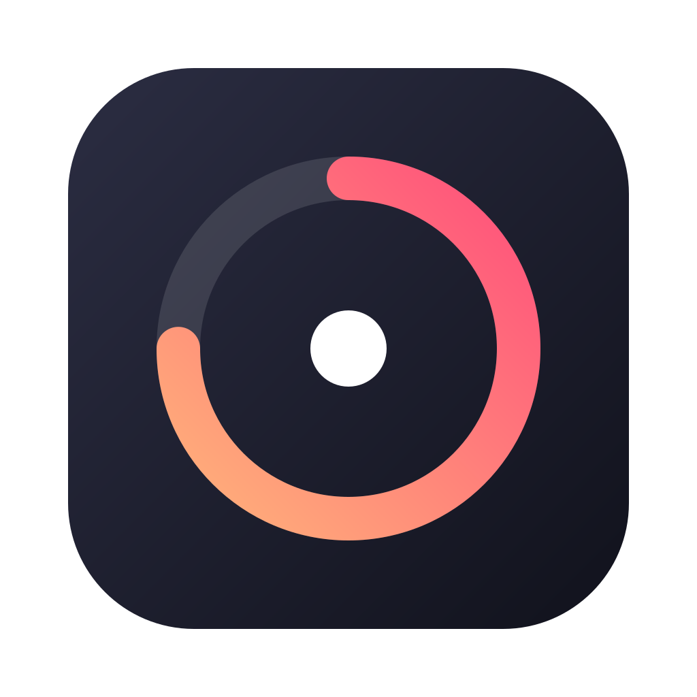
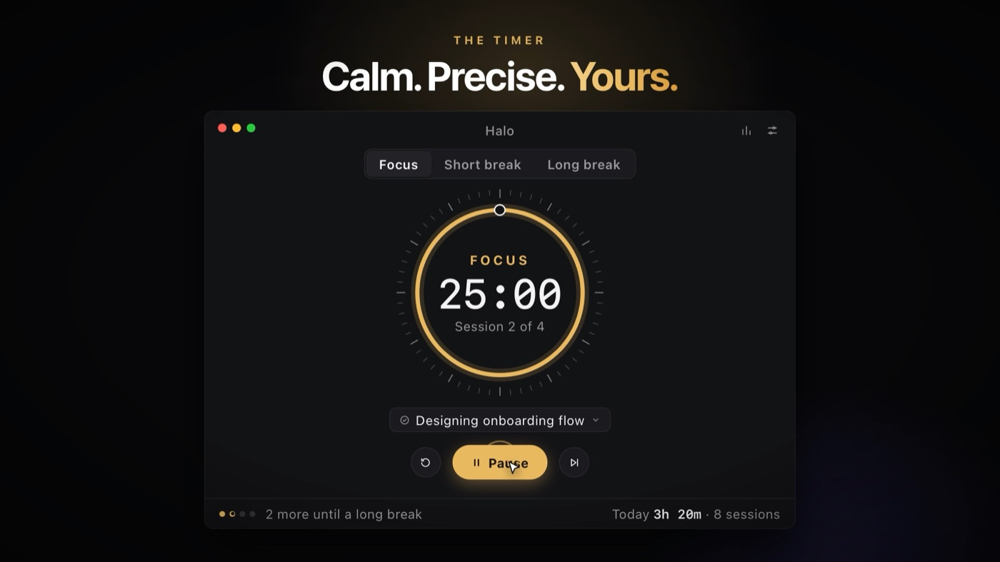
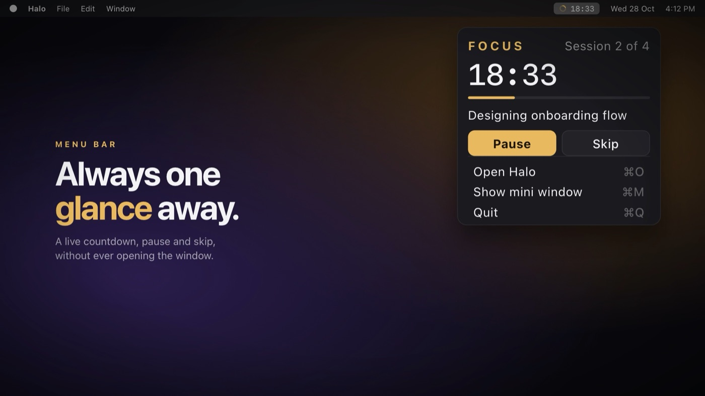
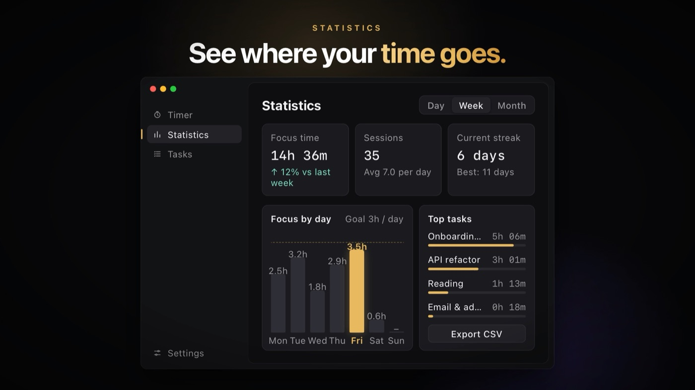
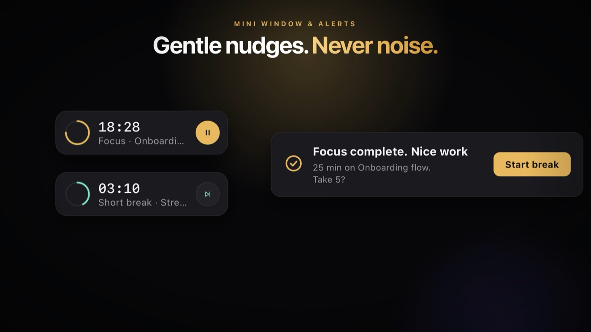

<p align="center">
  
</p>

<h1 align="center">Halo</h1>

<p align="center">
  <b>A calm, precise focus timer that lives in your menu bar, remembers what you worked on, and shows you where your time went.</b>
</p>

<p align="center">
  <a href="https://github.com/likhithrajuuu/halo/releases"></a>
  <a href="https://github.com/likhithrajuuu/halo/releases/latest"></a>
  
  <a href="https://halo.likhithraju.tech"></a>
</p>

Halo follows the Pomodoro rhythm: **focus, rest, repeat**, with a longer break after every fourth session. Pick a task, press start, and let the ring keep time. Close the window and the countdown stays in your menu bar.

**Private. Local. Free.** No account, no cloud, no tracking. Your tasks and sessions never leave your computer.

<p align="center">
  
</p>

<p align="center"><sub>The timer: ring, task, session dots and today's total at a glance.</sub></p>

---

## Table of contents

- [Features](#features)
- [Install](#install)
- [How it works](#how-it-works)
- [Usage](#usage)
  - [The timer](#the-timer)
  - [Tasks](#tasks)
  - [Statistics](#statistics)
  - [Menu bar and mini window](#menu-bar-and-mini-window)
  - [Keyboard shortcuts](#keyboard-shortcuts)
  - [Settings](#settings)
- [Updates](#updates)
- [Storage and privacy](#storage-and-privacy)
- [Platform support and known limitations](#platform-support-and-known-limitations)
- [Troubleshooting](#troubleshooting)
- [Feedback](#feedback)
- [License](#license)

## Features

- **A complete focus cycle**: focus, short break and long break, with dots that show how close you are to your next long break. Every length is adjustable.
- **Tasks**: choose what you're working on and every focus session is logged against it.
- **Statistics**: day, week and month views, streaks, a daily goal line, and your top tasks.
- **Menu bar countdown**: a live countdown beside your clock on macOS, and a popover to pause or skip without opening the window.
- **Mini window**: a small always-on-top timer you can drag anywhere.
- **Gentle alerts**: optional notifications and soft sounds when a session ends, with three tones and your own volume.
- **Flow on your terms**: breaks and focus sessions can start automatically, or stay in your hands.
- **Make it yours**: four accent colours and optional tick marks around the ring.
- **Keeps timing in the background**: closing the window keeps the timer running in the menu bar or tray.
- **Automatic updates**: signed updates arrive with one click.
- **Local and offline**: your data lives on your device, and Halo needs no internet connection to work.

<p align="center">
  
</p>

## Install


Grab the latest build from the **[Releases page](https://github.com/likhithrajuuu/halo/releases/latest)** or from **[halo.likhithraju.tech](https://halo.likhithraju.tech)**:

| Platform | File                                                          |
| -------- | ------------------------------------------------------------- |
| macOS    | `Halo_*_universal.dmg` (Apple silicon and Intel, macOS 11+)   |
| Windows  | `Halo_*_x64-setup.exe` or `Halo_*_x64_en-US.msi` (Windows 10/11) |
| Linux    | `Halo_*_amd64.AppImage`, `.deb` or `.rpm` (64-bit)            |

**macOS with Homebrew**

```bash
brew install --cask likhithrajuuu/tap/halo
```

> [!NOTE]
> Halo is **not yet signed** with a paid developer certificate, so your system may ask you to confirm it once.
> **macOS:** right-click Halo and choose **Open**, or go to System Settings → Privacy & Security and click **Open Anyway** (installing with Homebrew skips this).
> **Windows:** in SmartScreen choose **More info → Run anyway**.

On first launch Halo opens its window. After that it also lives in your **menu bar** (macOS) or **system tray** (Windows and Linux); look for the ring icon.

## How it works

Halo counts **focus sessions**. Each time you finish one, it moves to a short break, until you reach the number you've chosen (four by default), when the next break is a long one. After a long break the count starts over.

```text
Focus → Short break → Focus → Short break → Focus → Short break → Focus → Long break → (repeat)
```

- Only **completed focus sessions** count toward your statistics and your cycle.
- **Skipping** a focus session takes you to a break without counting it. Skipping a break takes you back to focus.
- The countdown follows the wall clock, so it stays accurate even when Halo is in the background.

## Usage

### The timer

| Control              | What it does                                                                                       |
| -------------------- | -------------------------------------------------------------------------------------------------- |
| **Focus / Short break / Long break** | Switch the timer to that mode. Switching stops the current countdown.                |
| **Start / Pause / Resume** | Starts the countdown, pauses it, or continues a paused one.                                  |
| **Reset** (↺)        | Stops the countdown and puts the time back to the full length.                                     |
| **Skip** (⏭)         | Moves to the next phase without recording the session.                                             |
| **Task chip**        | Choose the task this session counts toward, or add a new one.                                      |
| **Chart icon**       | Opens Statistics.                                                                                  |
| **Sliders icon**     | Opens Settings.                                                                                    |
| **Update to X.Y.Z**  | Appears when a new version is ready. One click downloads it and restarts Halo.                    |

The footer shows your session dots (filled for completed, ringed for the current one), how many sessions remain until a long break, and today's focus time.

### Tasks

Open **Tasks** from the sidebar (reach it from Statistics, or choose **Add a task…** in the task chip).

- Type a name and press **Add task**. The first task you add becomes the current one.
- Click the circle beside a task to **work on it**.
- Each task shows the total focus time logged against it.
- Deleting a task removes it from the list. Past sessions stay in your totals as "No task".

### Statistics

Open it with the chart icon in the timer window.

- **Range**: switch between **Day** (hours of the day), **Week** (Monday to Sunday) and **Month**.
- **Focus time** with the change from the previous period, **Sessions** with the daily average, and your **current and best streak**.
- **Focus by day** bars, with your daily goal as a dashed line and the highlighted bar for today.
- **Top tasks**, ranked by time.
- **Export CSV** copies every session (date, minutes and task) to your clipboard, ready to paste into a spreadsheet.

<p align="center">
  
</p>

### Menu bar and mini window

**Menu bar / tray**

- **macOS**: the remaining time sits beside the ring icon in the menu bar while a session runs.
- **Left-click** the icon (macOS and Windows) to open the popover: time, progress, current task, **Pause / Resume** and **Skip**, plus **Open Halo**, **Show mini window** and **Quit**. On Linux, the icon opens the tray menu instead.
- **Right-click** the icon for the full menu: Start or Pause, Reset, switch mode, Open, Settings and Quit.
- Closing the main window **keeps Halo running** in the menu bar or tray. Quit from the menu to exit completely.

**Mini window**

A small always-on-top timer with the ring, the time, the current mode and task, and a play/pause button. Drag it anywhere. Open it from the popover (**Show mini window**) and close it the same way.

<p align="center">
  
</p>

### Keyboard shortcuts

| Action                              | macOS                   | Windows and Linux |
| ----------------------------------- | ----------------------- | ----------------- |
| Start or pause                      | `Space` or `⌘↵`         | `Space`           |
| Reset the timer                     | `⌘R`                    | Reset button      |
| Focus / Short break / Long break    | `⌘1` / `⌘2` / `⌘3`      | Tabs or tray menu |
| Open Settings                       | `⌘,`                    | Tray menu         |
| Open Halo (in the popover)          | `⌘O`                    | Tray menu         |
| Show the mini window (in the popover) | `⌘M`                  | Tray menu         |
| Close the popover                   | `Esc`                   | `Esc`             |
| Hide the window (keeps running)     | `⌘W`                    | Close button      |
| Quit                                | `⌘Q`                    | Tray menu → Quit  |

`Space` works while the timer or popover window has focus (not while you're typing in a text box).

### Settings

Open Settings with the sliders icon, the menu bar, or `⌘,`.

- **Timer**: focus, short break and long break lengths; how many focus sessions come before a long break; start breaks and focus sessions automatically; your daily goal; and the completion sound (**Soft chime**, **Bell**, **Digital** or **None**).
- **Alerts**: show a notification when a session ends, set the sound volume (with a preview), show the countdown in the menu bar, and **open Halo at login**.
- **Appearance**: choose an accent colour (**Amber**, **Mint**, **Violet** or **Rose**) and turn the ring's tick marks on or off.
- **About**: your version, **Check for updates**, automatic update checks, and **Reset all data**.

| Setting             | Range                    | Default |
| ------------------- | ------------------------ | ------- |
| Focus               | 1 to 180 min             | 25 min  |
| Short break         | 1 to 60 min              | 5 min   |
| Long break          | 1 to 90 min              | 15 min  |
| Long break every    | 2 to 8 focus sessions    | 4       |
| Daily goal          | 30 to 720 min            | 180 min |
| Start breaks automatically | on / off          | on      |
| Start focus automatically  | on / off          | off     |

## Updates

Halo keeps itself up to date.

- It checks quietly a few seconds after it starts, and again every few hours.
- When a new version is ready, an **Update to X.Y.Z** button appears next to the settings icon. Click it and Halo downloads the update, installs it and restarts.
- You can also check yourself under **Settings → About → Check for updates**, or turn automatic checks off there.
- Every update is **cryptographically signed**, and Halo installs only updates signed by its author.
- **Linux:** automatic updates work for the AppImage. If you installed the `.deb` or `.rpm`, download the new version from the Releases page.
- **Homebrew:** `brew upgrade --cask halo` works too.

Your tasks, sessions and settings are kept across updates.

## Storage and privacy

- **No account, no cloud sync, no analytics.** Halo works fully offline.
- Your tasks, sessions and settings are stored **on your device**, in Halo's own app data folder.
- The **only** network request Halo makes is the update check, which asks GitHub whether a newer version exists. Turn it off in **Settings → About**.
- **Export CSV** copies your sessions to your clipboard. Nothing is uploaded anywhere.
- **Settings → About → Reset all data** removes your tasks, sessions and streaks. It can't be undone.
- To remove everything, uninstall Halo and delete its app data folder.

## Platform support and known limitations

Halo runs on all three platforms, but a few OS-level behaviours genuinely differ:

| Behaviour                       | macOS                                                        | Windows                                  | Linux                                                           |
| ------------------------------- | ------------------------------------------------------------ | ---------------------------------------- | --------------------------------------------------------------- |
| Minimum version                 | macOS 11 (Big Sur)                                           | Windows 10                               | 64-bit distribution with a recent system web view               |
| Countdown text in the menu bar  | Yes                                                          | Not shown (the tray icon has no text)    | Depends on your desktop; open the mini window to see the time   |
| Tray or menu bar icon           | Menu bar, adapts to light and dark                           | System tray (may be in the `^` overflow) | Needs a tray; GNOME needs a tray extension to show tray icons   |
| Closing the window              | Keeps running in the menu bar                                | Keeps running in the tray                | Quits the app                                                   |
| Full application menu           | Yes, with shortcuts                                          | No (use the tray menu)                   | No (use the tray menu)                                          |
| Automatic updates               | Yes                                                          | Yes                                      | AppImage only                                                   |
| Signed by a developer certificate | Not yet (confirm once on first launch)                     | Not yet (SmartScreen prompt)             | n/a                                                             |

If something behaves differently on your system than described here, please [open an issue](https://github.com/likhithrajuuu/halo-timer/issues) with your OS and version.

## Troubleshooting

<details>
<summary><b>I can't find the window or the icon</b></summary>

Halo keeps running when you close its window. Look for the ring icon in the menu bar (macOS) or the system tray (Windows, where it may be under the `^` overflow arrow). Click it to open the popover, or use **Open Halo**. On macOS you can also click the Dock icon.
</details>

<details>
<summary><b>macOS says Halo can't be opened, or that it's damaged</b></summary>

Halo isn't signed with a paid developer certificate yet. Right-click Halo in Applications and choose **Open**, or go to System Settings → Privacy & Security and click **Open Anyway**. Installing with Homebrew (`brew install --cask likhithrajuuu/tap/halo`) avoids this.
</details>

<details>
<summary><b>Windows SmartScreen blocks the installer</b></summary>

Choose **More info → Run anyway**. This is expected until Halo is signed with a paid certificate.
</details>

<details>
<summary><b>I don't see the countdown in my menu bar</b></summary>

The countdown text shows on macOS while a session is running or paused. Check **Settings → Alerts → Show countdown in menu bar** is on. On Windows the tray icon doesn't display text, and on Linux it depends on your desktop; open the popover or the mini window to see the time.
</details>

<details>
<summary><b>There's no tray icon on Linux</b></summary>

Some desktops, such as GNOME, don't show tray icons by default and need a tray extension (for example AppIndicator support). The timer window works everywhere. Note that on Linux, closing the window quits Halo.
</details>

<details>
<summary><b>I don't get notifications or sounds</b></summary>

Open **Settings → Alerts** and check **Show a notification** and the sound choice on the **Timer** tab. If notifications are on but nothing appears, allow Halo in your system's notification settings, and make sure Focus or Do Not Disturb isn't silencing it.
</details>

<details>
<summary><b>The Update button doesn't appear</b></summary>

Check **Settings → About**. You can press **Check for updates** there, and confirm automatic checks are on. Updates need an internet connection. If you're on a `.deb` or `.rpm` install, download the new version from the [Releases page](https://github.com/likhithrajuuu/halo/releases/latest) instead.
</details>

<details>
<summary><b>My statistics look wrong</b></summary>

Only **completed focus sessions** are counted. Skipped sessions and breaks don't appear. If you deleted a task, its past sessions are still in your totals, listed under "No task".
</details>

<details>
<summary><b>I want to start over</b></summary>

Go to **Settings → About → Reset all data**. Click it twice to confirm. This removes tasks, sessions and streaks, and can't be undone.
</details>

## Feedback

Found a bug or have an idea? [Open an issue](https://github.com/likhithrajuuu/halo-timer/issues). Please include your operating system and your Halo version (**Settings → About**).

## License

© 2026 Likhith Raju. All rights reserved. Halo is free to download and use.
